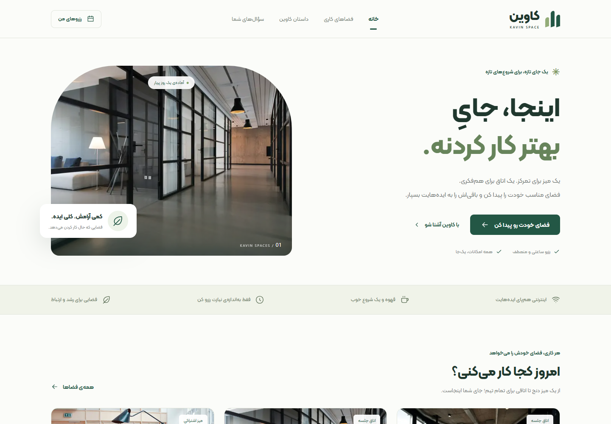
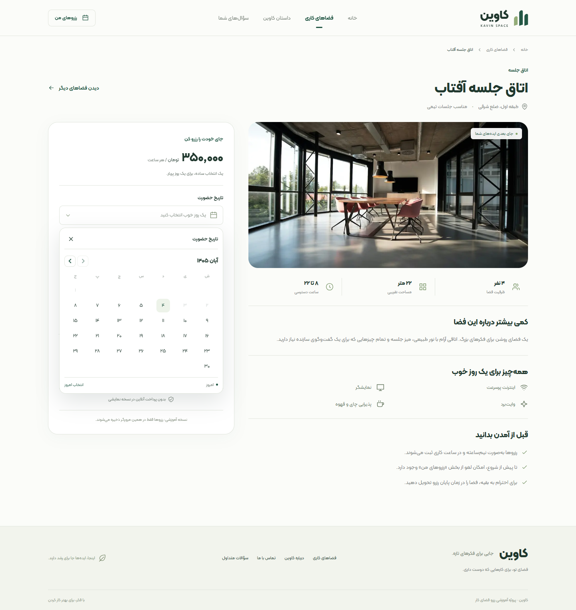

# کاوین | KAVIN

### فضای تو، برای بهتر کار کردن.

کاوین یک پروژه‌ی آموزشی رزرو فضای کار اشتراکی است؛ با رابط فارسی، تقویم شمسی و مسیر کامل انتخاب فضا تا ثبت و مدیریت رزرو. این برنچ، نسخه‌ی بازطراحی‌شده‌ی پروژه و پایه‌ی ادامه‌ی توسعه است.

**Next.js 16 · React 19 · TypeScript · Tailwind CSS 4 · React Hook Form · Zod · Playwright**

> وضعیت فعلی: فرانت‌اند قابل اجرا با داده‌های نمونه و ذخیره‌سازی محلی مرورگر. حساب کاربری، دیتابیس، بک‌اند و پرداخت واقعی هنوز پیاده‌سازی نشده‌اند.



[شروع و اجرا](#شروع-و-اجرا) · [امکانات](#چه-چیزهایی-آماده-است) · [تست‌ها](#تست-و-بررسی-کیفیت) · [دیزاین‌سیستم](DESIGN_SYSTEM.md) · [ادامه توسعه](HANDOFF.md)

## در این برنچ چه تغییر کرده؟

نسبت به نسخه‌ی اولیه، ظاهر صفحات و مسیر رزرو بازطراحی شده‌اند و پایه‌ی مشترکی برای ادامه‌ی کار ساخته شده است:

- تم روشن با رنگ‌های سبز و خنثی، فونت کلمه و نمایش راست‌به‌چپ.
- صفحه اصلی، کارت‌های فضا، جزئیات، فرم رزرو و صفحات عمومی هماهنگ.
- تقویم شمسی و انتخابگر ساعت اختصاصی با ظاهر و رفتار مشترک.
- محاسبه‌ی مبلغ براساس مدت حضور، به‌جای نمایش صرف قیمت ثابت فضا.
- ذخیره‌ی رزرو پس از ثبت؛ باقی‌ماندن آن با رفرش و لحاظ شدنش در بررسی تداخل.
- صفحه‌ی «رزروهای من» برای مشاهده و لغو رزرو، همراه با تأیید لغو.
- دیزاین‌سیستم مستند و صفحه‌ی زنده‌ی نمونه‌ی کامپوننت‌ها.
- تست‌های خودکار و راهنمای تحویل برای ادامه‌ی توسعه.

تاریخچه‌ی نسخه‌ی اولیه در Git محفوظ است. این تغییرها روی برنچ `feat/kavin-redesign` قرار دارند.

## چه چیزهایی آماده است؟

| بخش              | امکانات فعلی                                                             |
| ---------------- | ------------------------------------------------------------------------ |
| فهرست فضاها      | تصویر، نوع، ظرفیت، امکانات و قیمت ساعتی                                  |
| جستجو و فیلتر    | نام فضا، یکسان‌سازی ی/ک عربی، نوع فضا و حداقل ظرفیت                      |
| مرتب‌سازی        | پیشنهاد پیش‌فرض، کمترین و بیشترین قیمت                                   |
| صفحه جزئیات      | توضیح، موقعیت نمونه، مساحت، امکانات و قوانین حضور                        |
| فرم رزرو         | تاریخ شمسی، ساعت شروع و پایان، تعداد نفرات و پیش‌نمایش مبلغ              |
| اعتبارسنجی       | تاریخ و ساعت معتبر، زمان آینده، تعداد صحیح نفرات و ظرفیت                 |
| بررسی تداخل      | رد بازه‌ی اشغال‌شده، مجاز بودن بازه‌های مجاور و نادیده‌گرفتن رزرو لغوشده |
| ثبت رزرو         | ذخیره در مرورگر، شناسه‌ی رزرو و تأییدیه‌ی جزئیات                         |
| مدیریت رزرو      | رزروهای پیش رو، در حال انجام، گذشته و لغوشده؛ لغو پیش از شروع            |
| حالت‌های رابط    | بارگذاری، خطا، نتیجه خالی، تأیید و صفحه پیدا نشد                         |
| دسترس‌پذیری پایه | label فیلدها، پیام خطا، focus، کار با کیبورد و Escape                    |
| راهنمای طراحی    | رنگ‌ها، فونت، فاصله‌ها، اجزا و نمونه‌های تعاملی                          |

## شروع و اجرا

### پیش‌نیازها

- **Node.js نسخه 20.9 یا جدیدتر**؛ حداقل نسخه از نیازمندی Next.js این پروژه می‌آید.
- **npm** و **Git**.
- **Google Chrome** فقط برای اجرای تنظیم فعلی تست‌های مرورگر لازم است.

برای بررسی نسخه‌های نصب‌شده:

```bash
node --version
npm --version
git --version
```

### دریافت همین نسخه

```bash
git clone --branch feat/kavin-redesign --single-branch https://github.com/Narges-Safavi/Kavin.git
cd Kavin
npm ci
npm run dev
```

اگر مخزن را از قبل clone کرده‌ای، ابتدا تغییرهای محلی‌ات را نگه دار یا commit کن؛ سپس:

```bash
git fetch origin
git switch feat/kavin-redesign
npm ci
npm run dev
```

آدرس نمایش‌داده‌شده در ترمینال را باز کن؛ معمولاً **http://localhost:3000**.

اگر پورت ۳۰۰۰ اشغال است:

```bash
npm run dev -- --port 3002
```

پورت **۳۰۰۱** را برای سرور تست آزاد نگه دار. برای توقف سرور، در همان ترمینال `Ctrl + C` بزن.

**برای اجرای نسخه فعلی به دیتابیس، API key یا فایل `.env` نیاز نیست.**

### اجرای نسخه production روی سیستم خودت

```bash
npm run build
npm run start
```

`start` به build موفق نیاز دارد و به‌صورت پیش‌فرض روی پورت ۳۰۰۰ اجرا می‌شود. در صورت نیاز:

```bash
npm run start -- --port 3002
```

## مسیرهای برنامه

| مسیر                       | کاربرد                                       |
| -------------------------- | -------------------------------------------- |
| `/`                        | صفحه اصلی                                    |
| `/spaces`                  | فهرست، جستجو و فیلتر فضاها                   |
| `/spaces/1` تا `/spaces/4` | جزئیات چهار فضای نمونه و فرم رزرو            |
| `/bookings`                | مشاهده و لغو رزروهای همین مرورگر             |
| `/about`                   | داستان و معرفی کاوین                         |
| `/contact`                 | راهنمای ارتباط و وضعیت نسخه آموزشی           |
| `/faq`                     | سؤالات متداول                                |
| `/design-system`           | راهنمای توسعه و نمونه‌های تعاملی اجزای طراحی |

صفحه‌ی دیزاین‌سیستم از همان کامپوننت‌های واقعی محصول استفاده می‌کند و در منوی عمومی سایت قرار نگرفته است. این صفحه برای توسعه و مرجع طراحی است و `noindex` دارد.

## یک بار مسیر رزرو را امتحان کن

1. به «فضاهای کاری» برو و یک فضا انتخاب کن.
2. یک روز آینده، ساعت شروع و پایان و تعداد نفرات را مشخص کن.
3. مبلغ کل را ببین و رزرو را ثبت کن.
4. صفحه را رفرش کن و از «رزروهای من» وجود رزرو را بررسی کن.
5. دوباره همان روز و فضا را انتخاب کن؛ بازه‌ی اشغال‌شده نباید قابل انتخاب باشد.
6. رزرو آینده را لغو کن؛ باید در بخش لغوشده بماند و ساعت دوباره آزاد شود.

در صفحه‌ی `/design-system` هم می‌توانی تقویم، ساعت و فرم نمونه را امتحان کنی؛ آن نمونه‌ها رزروی ذخیره نمی‌کنند.

<details>
<summary>نمای فرم رزرو و تقویم شمسی</summary>



</details>

## قواعد رزرو در این نسخه

| موضوع       | قاعده                                                         |
| ----------- | ------------------------------------------------------------- |
| ساعت کاری   | ۰۸:۰۰ تا ۲۲:۰۰                                                |
| دقت انتخاب  | نیم ساعت                                                      |
| تعداد نفرات | عدد صحیح، حداقل یک نفر و حداکثر ظرفیت فضا                     |
| شروع حضور   | بعد از زمان فعلی مرورگر                                       |
| پایان حضور  | بعد از ساعت شروع و حداکثر تا پایان ساعت کاری                  |
| هزینه       | قیمت ساعتی کل فضا × مدت حضور؛ نه قیمت به‌ازای هر نفر          |
| لغو         | فقط پیش از شروع رزرو                                          |
| تداخل       | بازه‌ی `[start, end)`؛ مثلاً ۱۰ تا ۱۱ با ۱۱ تا ۱۲ تداخل ندارد |

تاریخ برای کاربر شمسی است، اما در داده به شکل میلادی `YYYY-MM-DD` نگهداری می‌شود. ساعت داخلی `HH:mm` است و برای نمایش فارسی می‌شود.

تاریخ روز رزرو با اجزای **زمان محلی** ساخته می‌شود؛ از `toISOString()` برای تعیین روز محلی استفاده نمی‌کنیم. زمان ثبت رکورد، جدا از روز رزرو، به‌صورت timestamp ذخیره می‌شود.

## ساختار کد و جریان داده

```text
app/
  page.tsx                     صفحه اصلی
  layout.tsx                   فونت، RTL، Navbar و Footer
  globals.css                  tokenها و استایل‌های مشترک
  spaces/
    page.tsx                   فهرست فضاها
    loading.tsx                بارگذاری مسیر فضاها
    [id]/page.tsx              جزئیات و فرم رزرو
  bookings/page.tsx            مدیریت رزروهای محلی
  design-system/               نمونه‌های زنده‌ی طراحی
  about/ contact/ faq/         صفحات عمومی
  error.tsx                    خطای قابل بازیابی
  not-found.tsx                صفحه پیدا نشد
components/
  ui/                          اجزای عمومی و انتخابگرها
  SpacesExplorer.tsx           جستجو، فیلتر و مرتب‌سازی
  SpaceCard.tsx                کارت استاندارد فضا
  ReservationForm.tsx          فرم و نمایش مبلغ
  ReservationConfirmation.tsx  تأییدیه‌ی رزرو
lib/
  data.ts                      مدل‌ها و چهار فضای نمونه
  date.ts                      تاریخ محلی، نمایش و مبلغ
  schemas.ts                   اعتبارسنجی Zod
  availability.ts              منطق خالص تداخل بازه‌ها
  booking-store.ts             مرز ذخیره‌سازی localStorage
  use-now.ts                   ساعت UI برای وضعیت‌های زمانی
tests/                         سناریوهای Playwright و منطق رزرو
public/images/                 تصاویر محلی فضاهای نمونه
docs/screenshots/              تصاویر README
scripts/                       ابزارهای بررسی و بسته‌بندی
```

جریان اصلی:

```text
صفحه فضا
  → ReservationForm
  → اعتبارسنجی Zod
  → createBooking
  → بررسی دوباره ورودی و تداخل
  → ذخیره موفق در مرورگر
  → تأییدیه و نمایش در رزروهای من
```

منطق تداخل در `availability.ts` از UI جداست. فرم نیز برای ثبت رزرو، مستقیم در `localStorage` نمی‌نویسد؛ این کار از مرز `booking-store.ts` انجام می‌شود. اتصال بعدی به API را از همین مرز شروع کن.

## دیزاین‌سیستم و تغییر ظاهر

ابتدا [راهنمای دیزاین‌سیستم](DESIGN_SYSTEM.md) را ببین و مسیر `/design-system` را در برنامه باز کن.

مقادیر پایه در ابتدای `app/globals.css` تعریف شده‌اند:

```css
:root {
  --primary: #235745;
  --primary-hover: #173e30;
  --primary-soft: #edf3e9;
  --background: #fbfcf9;
  --surface: #ffffff;
  --foreground: #20382e;
  --radius-sm: 9px;
  --radius: 16px;
  --radius-lg: 24px;
}
```

برای صفحه‌ی تازه از `Container`، `PageHeader`، `Button`، `Input` و اجزای موجود استفاده کن. اگر الگویی تکرار می‌شود، همان کامپوننت را توسعه بده؛ رنگ و استایل مشابه را در چند صفحه کپی نکن.

همه‌ی جزئیات ظاهری هنوز token مستقل ندارند. مقیاس فاصله و چند حالت ویژه در راهنمای طراحی توضیح داده شده‌اند؛ تغییر یک رنگ اصلی الزاماً تمام رنگ‌های اختصاصی را عوض نمی‌کند.

## تست و بررسی کیفیت

از ریشه پروژه اجرا کن:

```bash
npm run lint
npm run typecheck
npm test
npm run build
```

| دستور               | کاربرد                                  |
| ------------------- | --------------------------------------- |
| `npm run lint`      | بررسی قواعد کد و خطاهای رایج            |
| `npm run typecheck` | تولید نوع مسیرها و بررسی TypeScript     |
| `npm test`          | اجرای تست‌های Playwright                |
| `npm run test:ui`   | اجرای رابط تعاملی تست‌ها                |
| `npm run build`     | ساخت نسخه production و بررسی TypeScript |
| `npm run format`    | قالب‌بندی فایل‌های اصلی با Prettier     |

تست‌های موجود، جستجو و فیلتر، تقویم، ساعت، ورودی نامعتبر، ثبت و لغو، محاسبه هزینه، باقی‌ماندن رزرو پس از رفرش، خطای ذخیره‌سازی، همگام‌شدن دو تب و عدم تداخل را بررسی می‌کنند.

نمایش صفحه و انتخابگرها در عرض‌های **۳۲۰، ۳۹۰، ۷۶۸، ۱۰۲۴ و ۱۴۴۰** بررسی می‌شود. این تست، جای گوشی واقعی و آزمون Safari یا صفحه‌خوان را نمی‌گیرد.

### نکته‌های Playwright

- تنظیم پیش‌فرض از **Chrome نصب‌شده** با `channel: "chrome"` استفاده می‌کند.
- سرور تست روی `http://127.0.0.1:3001` اجرا می‌شود و در صورت نیاز خودکار بالا می‌آید.
- در اجرای محلی، اگر سروری روی همین پورت باشد، ممکن است دوباره استفاده شود؛ مطمئن شو متعلق به **همین checkout و همین برنچ** است.
- اگر Chrome نداری، `channel: "chrome"` را از `playwright.config.ts` بردار و مرورگر Playwright را نصب کن:

```bash
npx playwright install chromium
npm test
```

گزارش HTML بعد از تست:

```bash
npx playwright show-report
```

بررسی جداگانه‌ی صفحه دیزاین‌سیستم، با فرض روشن بودن برنامه روی پورت ۳۰۰۱:

```bash
node scripts/design-system-preview.cjs
```

اگر برنامه روی پورت پیش‌فرض توسعه یعنی ۳۰۰۰ روشن است، آدرس را صریح تعیین کن:

```powershell
$env:BASE_URL = "http://127.0.0.1:3000"
node scripts/design-system-preview.cjs
```

```bash
BASE_URL=http://127.0.0.1:3000 node scripts/design-system-preview.cjs
```

## ذخیره‌سازی و محدودیت‌های فعلی

رزروها با کلید `kavin.bookings.v1` در `localStorage` ذخیره می‌شوند و قبل از مصرف با Zod بررسی می‌شوند. تغییرات بین تب‌های همان مرورگر از رویداد `storage` دریافت می‌شود.

چند نکته‌ی مهم برای ادامه:

- رزروها فقط در همان **مرورگر و origin** هستند؛ `localhost`، `127.0.0.1` و پورت‌های متفاوت، فضای ذخیره‌سازی متفاوت دارند.
- پاک‌کردن اطلاعات مرورگر، رزروها را حذف می‌کند.
- حساب کاربری و همگام‌سازی بین دستگاه‌ها وجود ندارد.
- اطلاعات و تصاویر، نمونه‌اند و به معنی وجود محل یا امکان رزرو تجاری واقعی نیستند.
- ساعت و اعتبارسنجی فعلی از مرورگر کاربر می‌آیند و منبع قابل اعتماد سرور نیستند.
- بررسی محلی تداخل، جای تراکنش و کنترل اتمیک سمت سرور را نمی‌گیرد؛ دو کاربر واقعی ممکن است هم‌زمان یک بازه را درخواست کنند.
- قیمت، ظرفیت، ساعت و مجوز لغو باید در نسخه واقعی روی سرور هم بررسی شوند.
- نگهداری رمز عبور، session یا اطلاعات پرداخت را به این ذخیره‌سازی محلی اضافه نکن.

در این نسخه پرداخت آنلاین یا ثبت رزرو روی سرور انجام نمی‌شود.

## ادامه‌ی توسعه از کجا باشد؟

جزئیات در [HANDOFF.md](HANDOFF.md) آمده‌اند. ترتیب پیشنهادی:

1. **شناخت نسخه فعلی:** یک رزرو ثبت و لغو کن، سپس مسیر فرم، schema، availability و store را بخوان.
2. **قرارداد API:** شکل داده‌های فضا، کاربر و رزرو و پاسخ خطا را مشخص کن.
3. **حساب کاربری:** ورود، ثبت‌نام، بازیابی رمز و session امن.
4. **رزرو وابسته به کاربر:** جایگزینی ذخیره‌سازی محلی با API و نمایش رزروهای همان کاربر.
5. **قواعد سمت سرور:** زمان محل کسب‌وکار، قیمت، ظرفیت و جلوگیری اتمیک از رزرو هم‌زمان.
6. **حالت‌های واقعی رابط:** loading، retry، خطای دسترسی و وضعیت‌های API.
7. **کیفیت و انتشار:** گوشی واقعی، Safari/Firefox، دسترس‌پذیری، CI و استقرار.

هر تغییر را در یک branch و commit مشخص جلو ببر. پیش از تحویل، دستورهای کیفیت را اجرا کن و توضیح بده داده از کجا می‌آید، کجا بررسی و کجا ذخیره می‌شود. قابلیت‌های اضافی مثل انتخاب صندلی یا پنل مدیریت را بعد از پایدارشدن این مسیر اضافه کن.

## چند مشکل رایج

| مشکل                            | از کجا بررسی کنم؟                                                                |
| ------------------------------- | -------------------------------------------------------------------------------- |
| دستور npm پیدا نمی‌شود          | نصب Node.js و بازکردن مجدد ترمینال                                               |
| پروژه اجرا نمی‌شود              | قرار داشتن در پوشه‌ی `package.json` و انجام `npm ci`                             |
| پورت اشغال است                  | توقف سرور قبلی یا استفاده از `--port 3002`                                       |
| تست روی نسخه قدیمی اجرا می‌شود  | سرور در حال اجرای پورت ۳۰۰۱ و برنچ checkoutشده                                   |
| Playwright مرورگر پیدا نمی‌کند  | نصب Chrome یا استفاده از Chromium طبق راهنمای بالا                               |
| رزروها دیده نمی‌شوند            | مرورگر، آدرس و پورت اجرای قبلی؛ سپس داده محلی                                    |
| ساعت غیرفعال است                | انتخاب تاریخ و ساعت شروع، زمان فعلی، ساعت کاری و بازه‌های اشغال‌شده              |
| ثبت رزرو خطای ذخیره‌سازی می‌دهد | مجاز بودن storage و ظرفیت فضای مرورگر                                            |
| فضای جدید در مسیر پیدا نمی‌شود  | `generateStaticParams` و `dynamicParams = false` در صفحه جزئیات؛ راهنمای HANDOFF |

## مستندات همراه پروژه

- [DESIGN_SYSTEM.md](DESIGN_SYSTEM.md): قواعد طراحی و API کامپوننت‌ها.
- [HANDOFF.md](HANDOFF.md): وضعیت پروژه، تصمیم‌ها و کارهای بعدی.
- [QA.md](QA.md): گزارش بررسی‌ها و حدود پوشش تست.
- [AGENTS.md](AGENTS.md): راهنمای عامل‌های کدنویسی در این مخزن.
- [CLAUDE.md](CLAUDE.md): ارجاع به راهنمای مشترک پروژه.

## تصاویر نمونه

عکس‌های نمونه از Unsplash دریافت و در `public/images` قرار گرفته‌اند؛ نماینده‌ی محل واقعی کسب‌وکار نیستند:

- [تصویر اتاق جلسه](https://images.unsplash.com/photo-1497366811353-6870744d04b2)
- [تصویر فضای کاری](https://images.unsplash.com/photo-1497366754035-f200968a6e72)
- [تصویر فضای مشترک](https://images.unsplash.com/photo-1524758631624-e2822e304c36)
- [تصویر دفتر](https://images.unsplash.com/photo-1497366412874-3415097a27e7)

تصاویر محلی‌اند و برای نمایش آن‌ها نیازی به دریافت مستقیم از Unsplash در زمان اجرای سایت نیست.
