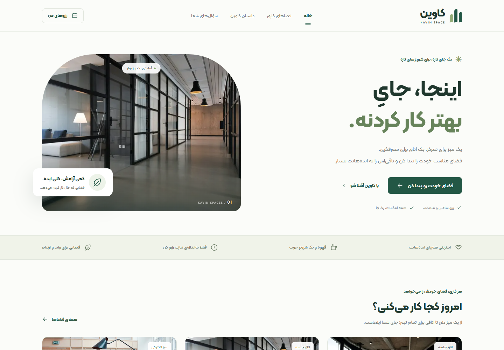

# کاوین | KAVIN

کاوین پروژهٔ رزرو فضای کار اشتراکی با رابط فارسی و تقویم شمسی است. فرانت Next.js، React و TypeScript به بک‌اند Django سعید متصل است. ورود، ثبت‌نام، فضاها، قیمت، ثبت و لغو رزرو از API استفاده می‌کنند. بازیابی رمز هنوز در دسترس نیست. وضعیت تست و محدودیت‌ها در [QA.md](QA.md) آمده است.



این تصویر مربوط به بازطراحی اولیه است، نه تأیید بصری نسخهٔ فعلی.

## راه‌اندازی محلی

دستورها برای Windows Command Prompt هستند. به Git، npm، Python 3.12 طبق راهنمای بک‌اند و Node.js نیاز داری. برای هماهنگی با محیط تست قبلی از Node.js 24 استفاده کن؛ سرور کاتالوگ تست به قابلیت `--experimental-strip-types` نیاز دارد. Google Chrome برای تنظیم فعلی Playwright لازم است.

```cmd
git clone https://github.com/Narges-Safavi/Kavin.git
cd Kavin
npm ci
```

در ترمینال اول، برای دیتابیس محلی تازه:

```cmd
cd backend
py -3.12 -m venv .venv
.venv\Scripts\python.exe -m pip install -r requirements.txt
.venv\Scripts\python.exe manage.py migrate
.venv\Scripts\python.exe manage.py loaddata spaces
.venv\Scripts\python.exe manage.py runserver 127.0.0.1:8000
```

اگر محیط و دیتابیس آماده‌اند، فقط سرور را اجرا کن. بارگذاری دوبارهٔ fixture می‌تواند فضاهای هم‌شناسه را بازنویسی کند. این fixture حساب نمی‌سازد؛ از صفحهٔ ثبت‌نام حساب بساز. گزینهٔ دیتای دمو و تنظیمات بک‌اند در [backend/README.md](backend/README.md) است.

در ترمینال دوم، از پوشهٔ دارای `package.json`:

```cmd
npm run dev
```

برنامه معمولاً در `http://localhost:3000` است. آدرس پیش‌فرض API برابر `http://127.0.0.1:8000/api/v1` است. برای تغییر آن، در `.env.local` ریشهٔ فرانت بنویس و سرور را دوباره اجرا کن:

```dotenv
NEXT_PUBLIC_KAVIN_API_URL=http://127.0.0.1:8000/api/v1
```

آدرس پایه اسلش آخر ندارد. این متغیر عمومی است؛ رمز و توکن در آن نگذار و `.env.local` را commit نکن. قرارداد در [backend/API.md](backend/API.md) و [OpenAPI](backend/openapi.yaml) است.

برای ساخت و اجرا در حالت production:

```cmd
npm run build
npm run start
```

آدرس API را پیش از build تعیین کن. هنگام استفاده، Django باید در دسترس باشد. کوکی در production دارای `Secure` است؛ ورود و خروج را روی HTTPS محیط مقصد بررسی کن. موفقیت build به معنی تأیید استقرار نیست.

## امکانات و مسیرها

| مسیر | کاربرد |
| --- | --- |
| `/` و `/spaces` | فضاها از API، جستجو و فیلتر نوع و ظرفیت و مرتب‌سازی قیمت سمت سرور |
| `/spaces/{id}` | جزئیات، زمان آزاد، قیمت سرور و فرم رزرو |
| `/login` و `/signup` | ورود و ثبت‌نام |
| `/bookings` | مشاهده و لغو رزروهای حساب واردشده |
| `/forgot-password` | پیام عدم دسترسی، بدون اعلام ارسال ایمیل |
| `/about`، `/contact` و `/faq` | صفحات عمومی |
| `/design-system` | نمونه‌های توسعهٔ رابط، دارای noindex |

فیلترها در URL با `search`، `type`، `minCapacity` و `ordering` نگهداری می‌شوند. برای بررسی دستی، وارد شو، روز آینده و ساعت آزاد انتخاب کن، منتظر قیمت بمان، ثبت کن و پس از رفرش رزرو را ببین. سپس لغو کن و وضعیت لغوشده را بررسی کن.

## جریان داده و ساختار

| محل | مسئولیت |
| --- | --- |
| `lib/api.ts` | درخواست مشترک و خطاهای API |
| `lib/auth.ts`، `app/api/auth/` و `lib/session.ts` | حساب کاربری و کوکی HttpOnly به نام `kavin_token` |
| `lib/spaces.ts` و `lib/space-filters.ts` | دریافت فضا و فیلترهای URL |
| `app/api/kavin/[...path]/route.ts` | واسطهٔ Next و افزودن توکن سمت سرور |
| `lib/bookings-api.ts` | availability، quote، ثبت، فهرست و لغو |
| `components/ReservationForm.tsx` | اعتبارسنجی، قیمت سرور، انتظار و خطا و تلاش دوباره |
| `app/bookings/page.tsx` | مدیریت رزرو و تصویر از کاتالوگ API |
| `lib/data.ts` | نوع‌های مشترک و نمونه‌های دیزاین‌سیستم و تست |

مرورگر به Next درخواست می‌دهد و Next توکن کوکی را به Django می‌فرستد. رزروها در دیتابیس Django ذخیره می‌شوند، نه localStorage. توکن در اختیار JavaScript مرورگر نیست.

تاریخ API میلادی `YYYY-MM-DD` و ساعت `HH:mm` طبق قرارداد Asia/Tehran است. UI تاریخ شمسی نشان می‌دهد. quote ساعت را نگه نمی‌دارد؛ ثبت نهایی مرجع تأیید است. `401` در رزرو کاربر را به ورود می‌برد و `409 slot_taken` زمان‌های آزاد را تازه می‌کند.

## تست و بررسی کیفیت

سرور توسعهٔ خود را پیش از تست ببند تا قفل `.next/dev` تداخل نکند. مجموعه‌ها را جدا و پشت سر هم اجرا کن:

```cmd
npm run lint
npm run typecheck
npm run build
npx playwright test
npx playwright test --config playwright.integration.config.ts
```

| مجموعه | محیط |
| --- | --- |
| پیش‌فرض | Next روی 3001، کاتالوگ ساختگی روی 3011 و پاسخ‌های Mock مرورگر؛ بدون Django |
| یکپارچه | Next روی 3001، Django واقعی روی 8011، SQLite موقت با migration و fixture |

تست یکپارچه به `backend\.venv\Scripts\python.exe` و requirements نصب‌شده نیاز دارد. دیتابیس معمول توسعه را استفاده نمی‌کند. سرورها خودکار شروع می‌شوند و پورت‌ها باید آزاد باشند؛ سرور از قبل باز دوباره استفاده نمی‌شود. این تست جای بررسی دیتابیس و زیرساخت انتشار را نمی‌گیرد.

افزودن `--list` فقط فهرست تست‌ها را نشان می‌دهد. گزارش HTML پیش‌فرض با `npx playwright show-report` باز می‌شود. اجرای UI با `npm run test:ui` است.

بعد از پایان باید سرورهای تست بسته باشند. اگر ویندوز بعد از نمایش نتیجه متوقف نشد، `Ctrl+C` بزن و بررسی کن:

```cmd
netstat -ano | findstr LISTENING | findstr /C:":3001 " /C:":3011 " /C:":8011 "
```

اگر خروجی داشت، PID را با `tasklist /FI "PID eq شماره"` شناسایی کن و فقط فرایند متعلق به همین تست را ببند. همهٔ Nodeها یا Pythonها را یکجا متوقف نکن.

## محدودیت‌ها و عیب‌یابی

- بازیابی رمز و ارسال ایمیل به قرارداد و پیاده‌سازی بک‌اند نیاز دارند.
- فهرست رزروها حداکثر ۱۰۰ مورد دریافت می‌کند و رابط صفحه‌بندی ندارد.
- تصویر رزرو از فضاهای فعال می‌آید. تصویر خراب، فضای غیرفعال یا خطای کاتالوگ با آیکون جایگزین نمایش داده می‌شود.
- یکسان‌سازی ورودی جستجو، یکسان‌سازی همهٔ حروف در دادهٔ ذخیره‌شدهٔ Django را تضمین نمی‌کند.
- گوشی واقعی، Safari، صفحه‌خوان، منطقهٔ زمانی دیگر و HTTPS مقصد نیازمند بررسی نهایی‌اند.
- پرداخت، تغییر زمان رزرو، انتخاب صندلی و پنل مدیریت فرانت پیاده‌سازی نشده‌اند.

اگر فضاها باز نمی‌شوند، اجرای Django و آدرس API را بررسی کن. اگر رزرو دیده نمی‌شود، حساب واردشده و پاسخ درخواست فهرست رزرو را بررسی کن. برای تستی که شروع نمی‌شود، Chrome، Node، پورت‌ها، قفل توسعه و محیط مجازی بک‌اند را بررسی کن.

ادامهٔ کار در [HANDOFF.md](HANDOFF.md)، طراحی در [DESIGN_SYSTEM.md](DESIGN_SYSTEM.md) و قواعد همکاری در [AGENTS.md](AGENTS.md) است. تصاویر نمونهٔ محلی نمایندهٔ محل تجاری واقعی نیستند. منابع: [اتاق جلسه](https://images.unsplash.com/photo-1497366811353-6870744d04b2)، [فضای کاری](https://images.unsplash.com/photo-1497366754035-f200968a6e72)، [فضای مشترک](https://images.unsplash.com/photo-1524758631624-e2822e304c36) و [دفتر](https://images.unsplash.com/photo-1497366412874-3415097a27e7).
